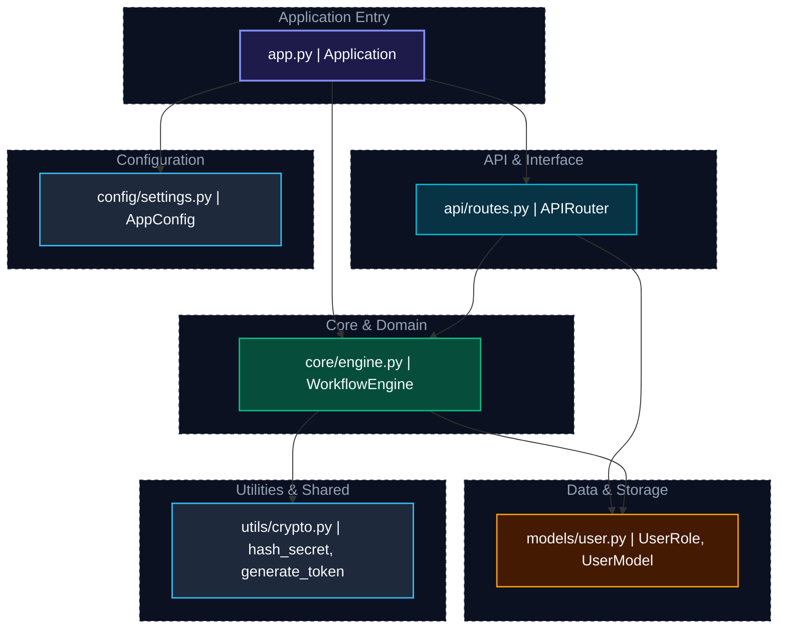

# Architecture Overview: demo_project

## 🤖 AI Architecture Analysis (Powered by Google Gemma)

### Executive Summary
**demo_project** exhibits a structured **Clean N-Tier Layered Architecture** architecture comprising 6 Python modules across 6 functional layers. Execution coordinates through clear boundaries (API & Interface, Application Entry, Configuration), delivering high operational cohesion with 7 cross-module dependency links.

### Architecture Health: A
Exceptional decoupling. Strict acyclic dependency flow with well-balanced fan-in and fan-out.

### Identified Design Patterns
- **Clean N-Tier Layered Architecture**: Strict separation between interface endpoints, core business orchestrator, and persistent entity storage.
- **Dispatcher & Facade Pattern**: Centralized interface routing layer that encapsulates endpoint dispatching from domain execution.
- **Core Domain Workflow Orchestrator**: Encapsulated business logic coordinator driving application operations and managing state transitions.
- **Data Entity & Domain Model**: Explicit entity classes encapsulating attributes and schema invariants.
- **Stateless Shared Service Provider**: Shared utility helpers providing reusable cryptographic, string, or mathematical primitives.

### Architectural Recommendations
- Preserve downward dependency flows: enforce that 'API & Interface' only calls into lower tiers, never in reverse.
- Maintain zero circular imports to guarantee sub-millisecond cold start times and clean unit test isolation.

